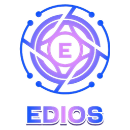
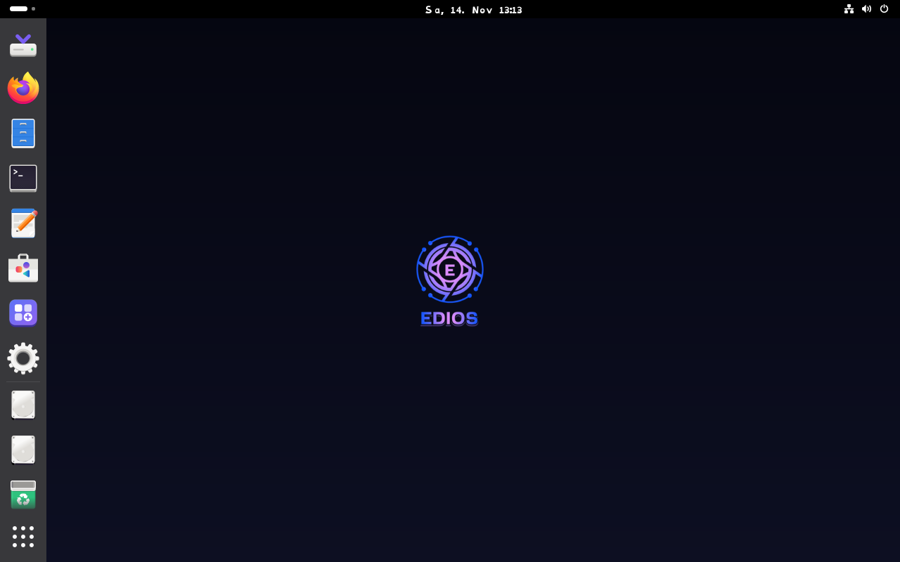
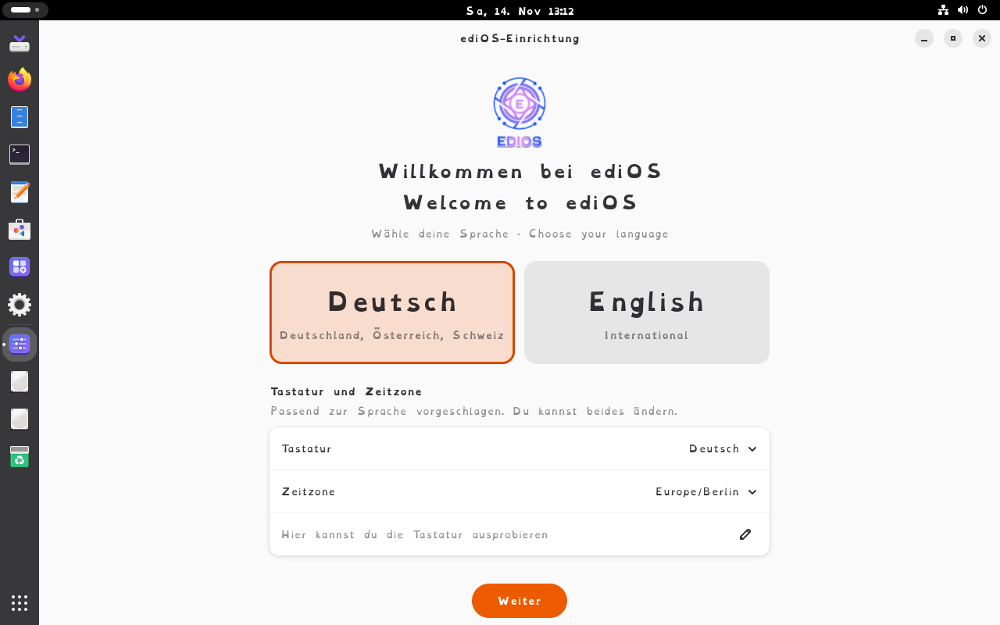
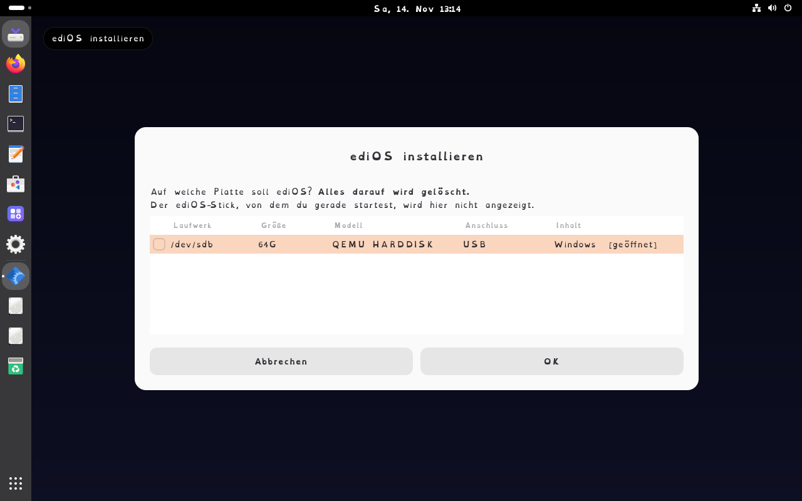
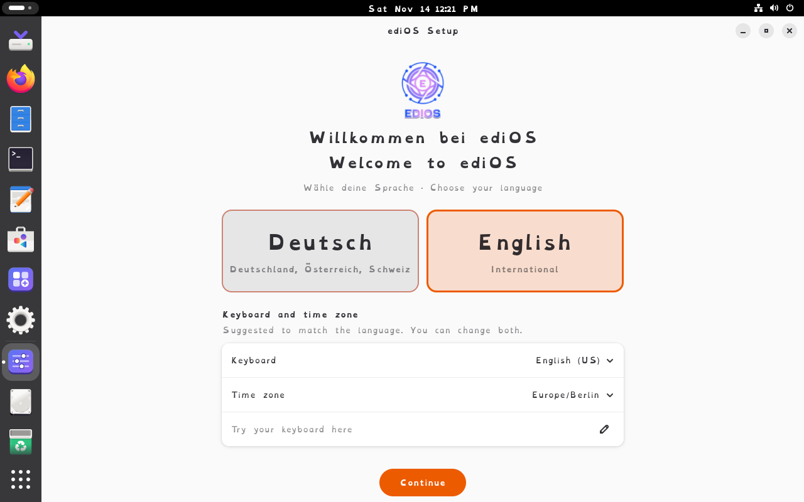
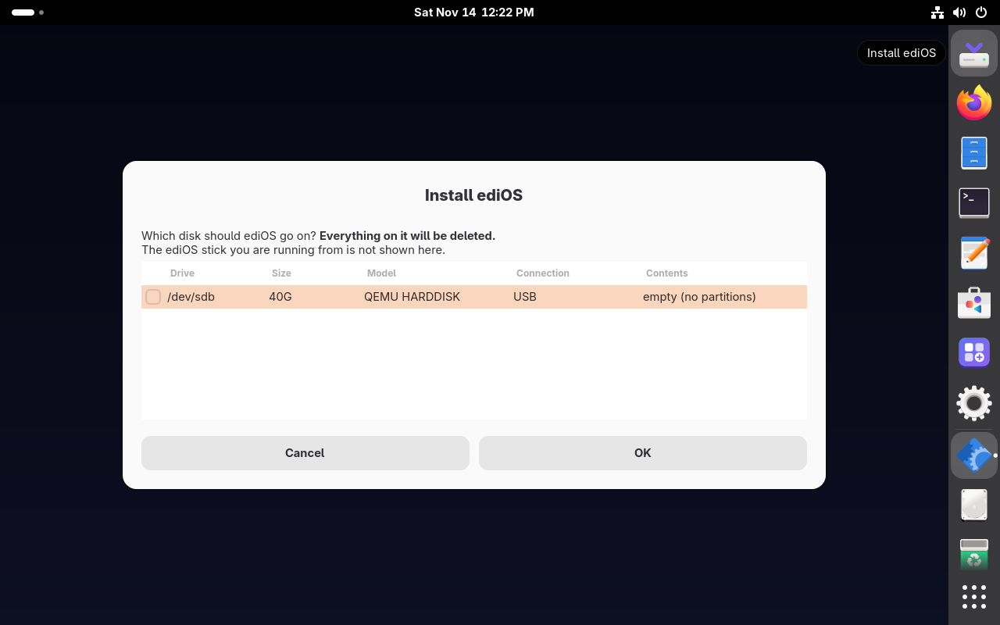

<h1 align="center">ediOS</h1>

<b>Deutsch</b> · <a href="#english">English</a>

ediOS ist ein einfaches, freundliches Linux für den Alltag. Es basiert auf **Alpine Linux** mit dem
**GNOME**-Desktop, startet als Live-System vom USB-Stick und lässt sich mit einem grafischen Installer auf eine
Platte installieren. ediOS spricht **Deutsch und Englisch**, startet mit **Secure Boot** und bringt Updates mit
einem Klick.

| | |
|---|---|
|  |  |

## Was ist drin?
- GNOME-Desktop mit Dock (links, unten oder rechts), Firefox, LibreOffice, Dateien, Terminal
- **Einrichtung** beim ersten Start: Sprache (Deutsch/English), Tastatur, Zeitzone, Schrift (auch
  **OpenDyslexic** für Menschen mit Legasthenie) und Dock-Position
- **ediOS Apps:** Steam, Discord, Spotify, GIMP und mehr mit einem Klick (Flathub)
- **ediOS aktualisieren:** System, ediOS und Apps auf den neuesten Stand bringen
- Secure Boot (über shim), Firewall ab Werk an, `sudo` funktioniert

## Systemanforderungen
- 64-Bit-PC (x86_64) mit **UEFI** (Secure Boot an oder aus)
- **4 GB RAM** (8 GB empfohlen; für „komplett in den RAM laden“ mindestens 8 GB)
- USB-Stick mit mindestens 4 GB; zum Installieren eine Platte mit mindestens 12 GB (z. B. externe USB-SSD)
- Grafik: Intel, AMD (auch neue Karten wie RX 9060 XT), NVIDIA nur mit dem freien Treiber nouveau

## Herunterladen
Die ISO gibt es unter **[Releases](https://github.com/edululilar-sketch/ediOS/releases/latest)**:
`edios-1.0-x86_64.iso`, dazu `SHA256SUMS` (Prüfsumme) und `SHA256SUMS.sig` (Signatur).

## Installieren (Kurzfassung)
1. ISO herunterladen und Prüfsumme kontrollieren.
2. Mit **Rufus** oder **balenaEtcher** auf einen USB-Stick schreiben.
3. Vom Stick starten (Boot-Menü, meist F12/F11/Esc) und im ediOS-Menü **Deutsch** wählen.
4. Bei Secure Boot: einmal den ediOS-Schlüssel eintragen (blauer MOK-Manager).
5. Einrichtung durchklicken, dann **ediOS installieren** aus dem Dock starten.

➡️ **Ausführliche Anleitung mit Bildern: [docs/de/installation.md](docs/de/installation.md)**

## Updates
„**ediOS aktualisieren**“ in der App-Übersicht aktualisiert Alpine- und ediOS-Pakete sowie Flatpak-Apps.
Einmal pro Woche erscheint ein Hinweis, wenn es Updates gibt. Es wird nie etwas ohne Nachfrage installiert.

## Bekannte Probleme
- Der Kernel bleibt wegen Secure Boot auf der Version der ISO; Kernel-Updates kommen mit neuen ediOS-Versionen.
- NVIDIA: nur der freie Treiber nouveau (kein proprietärer Treiber).
- Die Zeitzone in GNOME-Einstellungen → Datum & Uhrzeit lässt sich nicht ändern (braucht systemd);
  dafür gibt es die **ediOS-Einrichtung**.
- Das Bootmenü zeigt keine Umlaute (GRUB hat dort keine passende Schrift).

## Fehler melden
Bitte über **[Issues](https://github.com/edululilar-sketch/ediOS/issues/new/choose)** („Fehler melden (Deutsch)“).
Hilfreich: ediOS-Version, PC-Modell und was genau passiert ist.

## Selbst bauen
Siehe [docs/de/bauen.md](docs/de/bauen.md). Copyright (C) 2026 ediOS-Mitwirkende.
Lizenz: [GPL-3.0-or-later](LICENSE), fremde Teile:
[THIRD-PARTY.md](THIRD-PARTY.md), Änderungen: [CHANGELOG.md](CHANGELOG.md).

---

<a href="#">Deutsch</a> · <b>English</b>

ediOS is a simple, friendly Linux for everyday use. It is based on **Alpine Linux** with the **GNOME** desktop,
starts as a live system from a USB stick and can be installed on a disk with a graphical installer. ediOS speaks
**English and German**, starts with **Secure Boot** and brings updates with one click.

| | |
|---|---|
|  |  |

## What's inside?
- GNOME desktop with a dock (left, bottom or right), Firefox, LibreOffice, Files, Terminal
- **Setup** at the first start: language (English/German), keyboard, time zone, font (including
  **OpenDyslexic** for people with dyslexia) and dock position
- **ediOS Apps:** Steam, Discord, Spotify, GIMP and more with one click (Flathub)
- **Update ediOS:** bring the system, ediOS and your apps up to date
- Secure Boot (via shim), firewall on by default, `sudo` works

## System requirements
- 64-bit PC (x86_64) with **UEFI** (Secure Boot on or off)
- **4 GB RAM** (8 GB recommended; at least 8 GB for "load completely into RAM")
- USB stick with at least 4 GB; to install, a disk with at least 12 GB (e.g. an external USB SSD)
- Graphics: Intel, AMD (including new cards like the RX 9060 XT), NVIDIA only with the free nouveau driver

## Download
The ISO is available under **[Releases](https://github.com/edululilar-sketch/ediOS/releases/latest)**:
`edios-1.0-x86_64.iso`, plus `SHA256SUMS` (checksum) and `SHA256SUMS.sig` (signature).

## Install (short version)
1. Download the ISO and check the checksum.
2. Write it to a USB stick with **Rufus** or **balenaEtcher**.
3. Start from the stick (boot menu, usually F12/F11/Esc) and choose **English** in the ediOS menu.
4. With Secure Boot: enroll the ediOS key once (blue MOK manager).
5. Go through the setup, then start **Install ediOS** from the dock.

➡️ **Detailed guide with pictures: [docs/en/installation.md](docs/en/installation.md)**

## Updates
"**Update ediOS**" in the app overview updates Alpine and ediOS packages and Flatpak apps. Once a week a
notification appears when updates are available. Nothing is ever installed without asking.

## Known issues
- Because of Secure Boot the kernel stays at the version of the ISO; kernel updates come with new ediOS versions.
- NVIDIA: only the free nouveau driver (no proprietary driver).
- The time zone in GNOME Settings → Date & Time cannot be changed (needs systemd); use **ediOS Setup** instead.
- The boot menu shows no umlauts (GRUB has no suitable font there).

## Report a bug
Please use **[Issues](https://github.com/edululilar-sketch/ediOS/issues/new/choose)** ("Report a bug (English)").
Helpful: ediOS version, PC model and what exactly happened.

## Build it yourself
See [docs/en/building.md](docs/en/building.md). Copyright (C) 2026 ediOS contributors.
License: [GPL-3.0-or-later](LICENSE), third-party parts:
[THIRD-PARTY.md](THIRD-PARTY.md), changes: [CHANGELOG.md](CHANGELOG.md).
