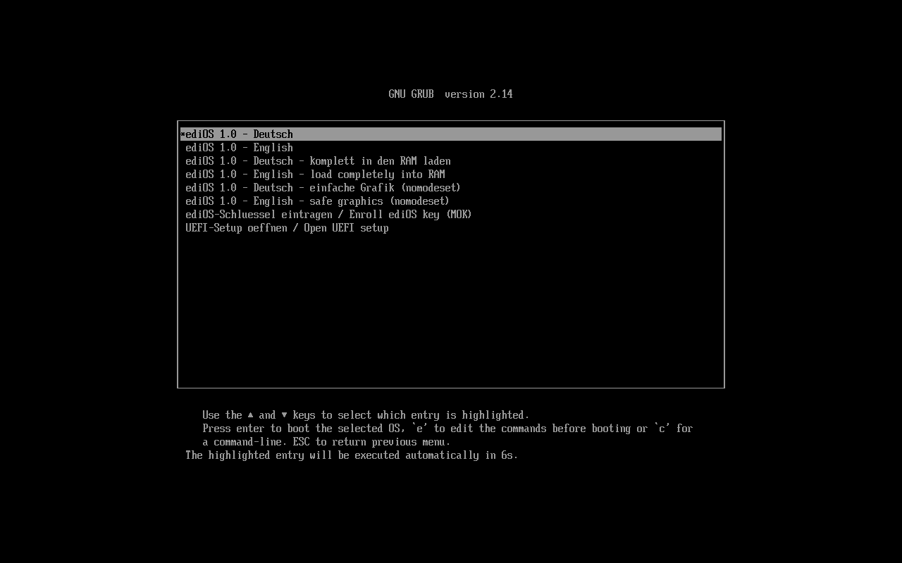
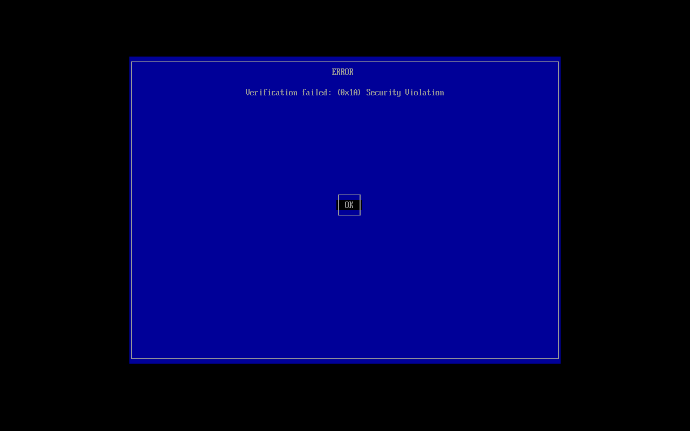
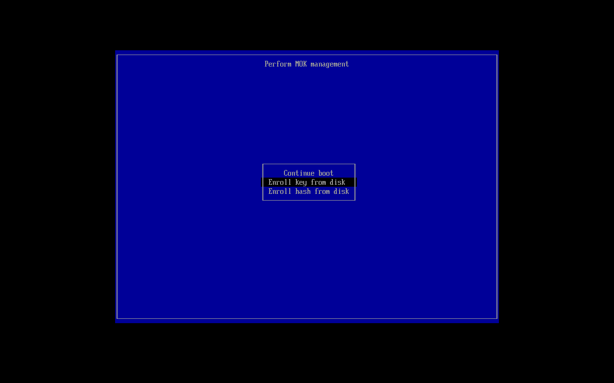
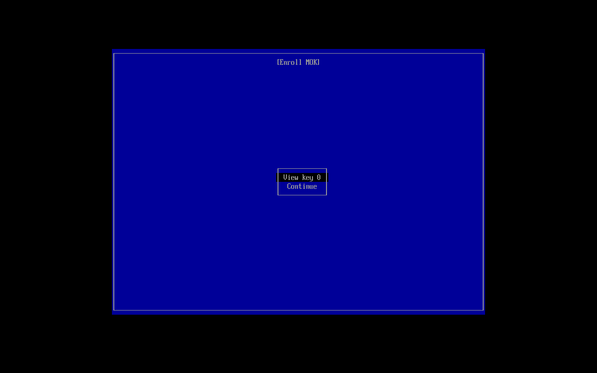
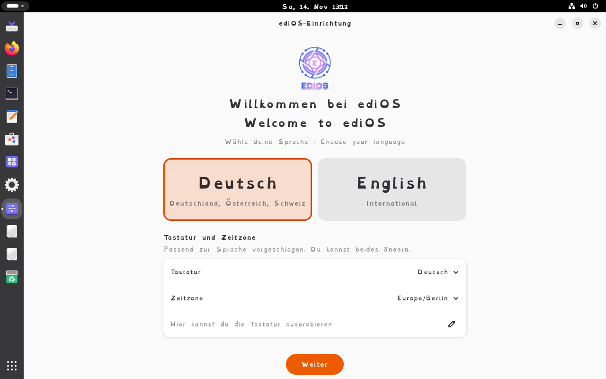
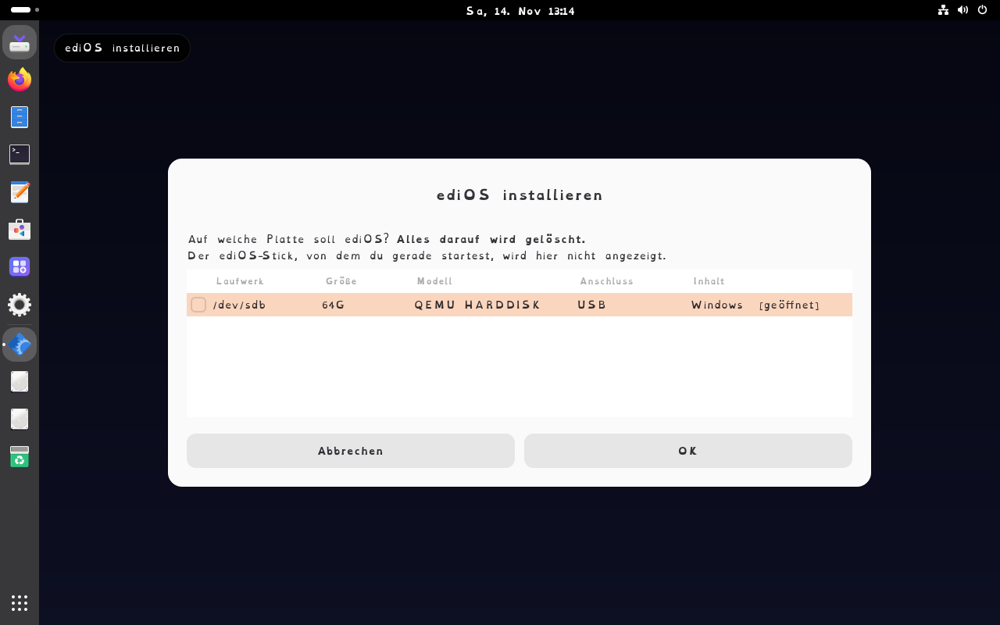
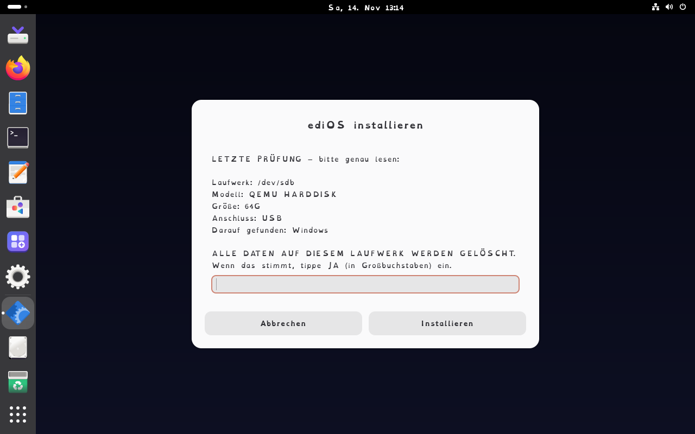
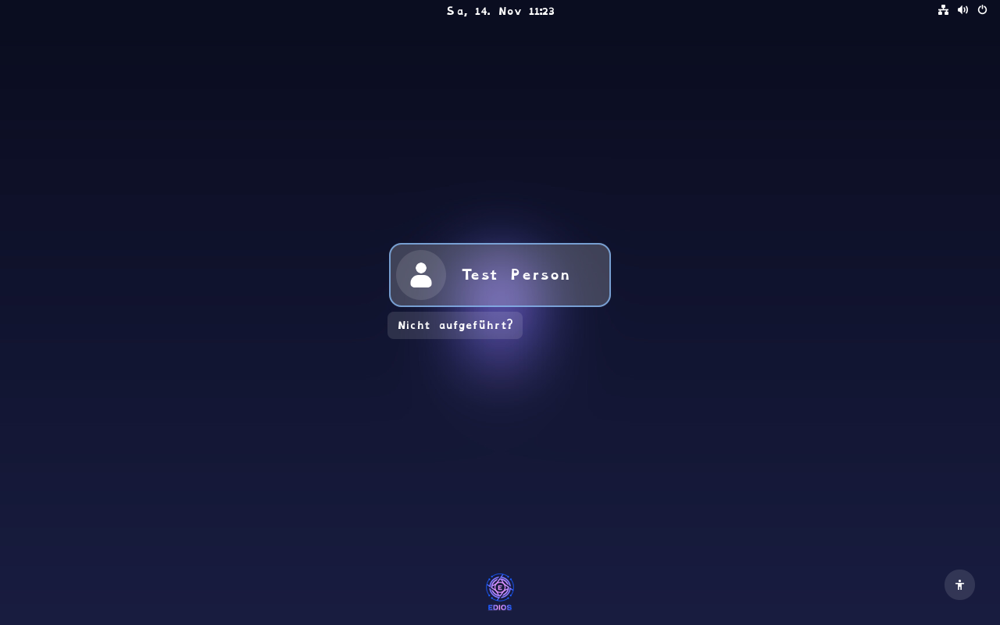
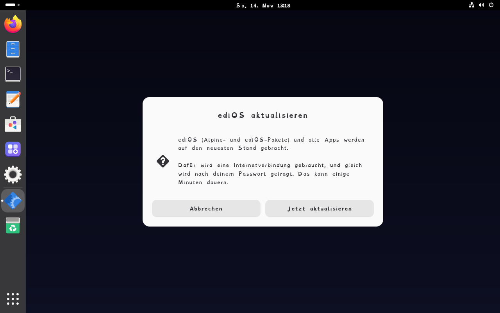
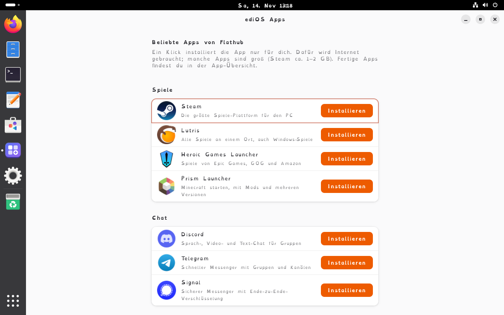

# ediOS installieren – Schritt für Schritt

[English](../en/installation.md) · [Zurück zur Übersicht](../../README.md)

Diese Anleitung ist für Einsteiger geschrieben. Du brauchst etwa 30–45 Minuten.

**Du brauchst:**
- einen PC mit UEFI (fast alle PCs ab 2012) und mindestens 4 GB Arbeitsspeicher
- einen USB-Stick mit mindestens 4 GB – **alles darauf wird gelöscht**
- zum Installieren eine Platte mit mindestens 12 GB, am einfachsten eine **externe USB-SSD**
  (dann bleibt dein Windows unberührt)
- Internet für den Download (etwa 2 GB)

> **Wichtig:** Beim Installieren wird die gewählte Platte komplett gelöscht. Sichere vorher deine Daten.

---

## 1. ISO herunterladen

1. Öffne die Seite **[Releases](https://github.com/edululilar-sketch/ediOS/releases/latest)**.
2. Lade unter „Assets“ diese Dateien herunter:
   - `edios-1.0-x86_64.iso` – das ist ediOS (etwa 1,9 GB)
   - `SHA256SUMS` – die Prüfsumme

## 2. Prüfsumme kontrollieren

Damit stellst du sicher, dass die Datei vollständig und unverändert ist.

**Windows:** Öffne den Download-Ordner, klicke mit der rechten Maustaste auf einen freien Bereich →
„Im Terminal öffnen“ (oder PowerShell) und gib ein:

```powershell
Get-FileHash .\edios-1.0-x86_64.iso -Algorithm SHA256
```

Vergleiche die angezeigte Zahl mit der Zeile in `SHA256SUMS` (mit dem Editor öffnen). Sie muss **genau gleich**
sein (Groß-/Kleinschreibung egal). Ist sie anders: Datei löschen und neu herunterladen.

**Linux/macOS:** `sha256sum -c SHA256SUMS --ignore-missing` muss `OK` melden.

<details><summary>Für Fortgeschrittene: Signatur prüfen</summary>

`SHA256SUMS.sig` ist mit dem ediOS-Paketschlüssel signiert. Den öffentlichen Schlüssel
`edios-repo.rsa.pub` gibt es im Release und im Repository unter `src/pubkeys/`.

```sh
openssl dgst -sha256 -verify edios-repo.rsa.pub -signature SHA256SUMS.sig SHA256SUMS
```

Ausgabe: `Verified OK`.
</details>

## 3. USB-Stick erstellen

### Mit Rufus (Windows)
1. **Rufus** von <https://rufus.ie> herunterladen (die „Portable“-Version reicht) und starten.
2. **Laufwerk:** deinen USB-Stick wählen. Genau hinsehen – es darf keine Festplatte sein!
3. **Startart:** „AUSWAHL“ klicken und `edios-1.0-x86_64.iso` wählen.
4. **Partitionsschema:** GPT, **Zielsystem:** UEFI (kein CSM).
5. **START** klicken. Rufus fragt, wie geschrieben werden soll: **„Im DD-Abbild-Modus schreiben“** wählen.
6. Die Warnung „Alle Daten werden gelöscht“ mit OK bestätigen und warten, bis „FERTIG“ erscheint.

### Mit balenaEtcher (Windows, macOS, Linux)
1. **balenaEtcher** von <https://etcher.balena.io> installieren und starten.
2. „Flash from file“ → `edios-1.0-x86_64.iso` wählen.
3. „Select target“ → den USB-Stick wählen.
4. „Flash!“ klicken und warten, bis „Flash Complete“ erscheint.

## 4. Im BIOS/UEFI vom Stick starten

1. Stick einstecken und den PC **neu starten**.
2. Gleich beim Start die Taste für das **Boot-Menü** drücken. Je nach Hersteller:

   | Hersteller | Taste |
   |---|---|
   | Acer, Asus (Desktop), Dell, Lenovo, Gigabyte, MSI | F12 / F11 |
   | Asus (Laptop) | Esc |
   | HP | F9 (oder Esc) |
   | Lenovo (manche) | F12 oder die kleine „Novo“-Taste |

3. Den Eintrag **„UEFI: …“** mit dem Namen deines Sticks wählen.
4. Das **ediOS-Startmenü** erscheint. Wähle **„ediOS 1.0 – Deutsch“** (oder warte 8 Sekunden).



Weitere Einträge:
- **komplett in den RAM laden:** ediOS kopiert sich in den Arbeitsspeicher. Danach kannst du den Stick abziehen
  (braucht mindestens 8 GB RAM).
- **einfache Grafik:** wenn der Bildschirm schwarz bleibt.

## 5. Secure Boot: den ediOS-Schlüssel eintragen

Ist **Secure Boot aus**, überspringe diesen Schritt.

Ist **Secure Boot an**, erscheint beim ersten Start eine Meldung. Das ist beim ersten Mal **richtig so**:



1. Mit **Enter** auf „OK“ bestätigen.
2. Ein **blauer Bildschirm** „Shim UEFI key management“ erscheint. Innerhalb von 10 Sekunden **eine Taste drücken**.
3. **„Enroll key from disk“** wählen.

   

4. Das Laufwerk **„EDIOS“** wählen, dann die Datei **`edios-mok.der`**.
5. Optional „View key“: der Name muss **„ediOS Secure Boot Signing Key (MOK) 2026-11“** lauten.
6. **„Continue“** → **„Yes“** → **„Reboot“**.



Danach startet ediOS mit Secure Boot. Der Schlüssel gilt nur für ediOS; Windows startet weiter ganz normal.

## 6. Live-System und Einrichtung

Nach etwa einer Minute erscheint der Desktop mit der **Einrichtung**:

1. **Sprache:** Deutsch oder English (die Tastatur und die Zeitzone werden passend vorgeschlagen).
   Im Feld „Hier kannst du die Tastatur ausprobieren“ kannst du testen, ob ä, ö, ü, z und y stimmen.

   

2. **Schriftart:** z. B. OpenDyslexic, die GNOME-Standardschrift oder Ubuntu – jede Änderung wirkt sofort.
3. **Dock-Position:** links, unten oder rechts. Dann **„Fertig“**.

Alles, was du hier auswählst, übernimmt der Installer ins installierte ediOS. Im Live-System kannst du ediOS in
Ruhe ausprobieren: WLAN (oben rechts), Ton, Firefox, Dateien. Nichts wird auf deinem PC verändert.

## 7. Installation

1. Klicke im Dock auf **„ediOS installieren“** (erstes Symbol).
2. Lies den Hinweis und klicke „Weiter“.
3. **Platte wählen:** Die Liste zeigt jede Platte mit Größe, Modell, Anschluss und Inhalt
   (z. B. „Windows“ oder „leer“). Der ediOS-Stick erscheint nie.

   

   Ist eine Platte gerade geöffnet (z. B. in „Dateien“), steht „[geöffnet]“ dahinter. Der Installer hängt sie
   nach einer Rückfrage aus.
4. **Benutzerkonto:** Name, Benutzername (klein, ohne Leerzeichen) und Passwort.
5. **Letzte Prüfung:** Lies alles genau. Wenn es stimmt, tippe **JA** ein und klicke „Installieren“.

   

6. Die Installation dauert etwa 5–10 Minuten. Am Ende erscheint „ediOS ist installiert“.

## 8. Erster Start

1. PC ausschalten und den **USB-Stick abziehen**.
   - **Externe Platte:** Sie bleibt dran. Beim Start im Boot-Menü (F12/F11/Esc) die Platte wählen.
     Ohne Auswahl startet der PC wie bisher (z. B. Windows).
   - **Interne Platte:** ediOS steht im Startmenü des PCs (bei Windows-PCs kommt Windows weiter zuerst).
2. Am Anmeldebildschirm deinen Benutzer anklicken und das Passwort eingeben.

   

3. Sprache, Schrift und Dock sind so wie im Live-System eingestellt; die Einrichtung erscheint nicht noch einmal.
   Ändern kannst du alles später mit **„ediOS-Einrichtung“** in der App-Übersicht.

## 9. Updates und Apps

- **„ediOS aktualisieren“** (App-Übersicht) bringt System, ediOS und Apps auf den neuesten Stand.
  Es fragt nach deinem Passwort. Einmal pro Woche erscheint ein Hinweis, wenn es Updates gibt.

  

- **„ediOS Apps“** installiert beliebte Programme wie Steam, Discord, Spotify oder GIMP mit einem Klick.

  

- Befehle aus Anleitungen im Internet mit `sudo` funktionieren in ediOS.

---

## Probleme und Lösungen

**Der Stick startet nicht / erscheint nicht im Boot-Menü**
- Anderen USB-Anschluss probieren (am PC hinten, USB 2.0 geht oft besser).
- Im UEFI-Setup (meist F2 oder Entf beim Start) „Fast Boot“ ausschalten.
- Stick mit Rufus noch einmal schreiben, diesmal „Im ISO-Abbild-Modus schreiben“.
- Steht im Boot-Menü der Stick zweimal: den Eintrag mit **„UEFI:“** wählen.

**Secure-Boot-Fehler („Security Violation“ oder „ediOS konnte nicht gestartet werden“)**
- Beim ersten Start ist das normal: Schritt 5 durchführen.
- Kein blauer Bildschirm? Im ediOS-Startmenü **„ediOS-Schluessel eintragen“** wählen.
- Es klappt gar nicht: Secure Boot im UEFI-Setup ausschalten (Bereich „Security“ oder „Boot“). ediOS startet
  dann immer. Für Windows 11 kannst du es danach wieder einschalten, wenn der Schlüssel eingetragen ist.

**Eine Platte fehlt in der Liste des Installers**
- Platten unter 12 GB und der ediOS-Stick selbst werden nicht angezeigt.
- Externe Platte erst nach dem Start anschließen, ein paar Sekunden warten und den Installer neu starten.
- Bei NVMe-SSDs in manchen Laptops: im UEFI-Setup „Intel RST“/„RAID“ auf „AHCI“ stellen (Achtung: Windows
  vorher darauf vorbereiten).

**Kein WLAN**
- Oben rechts auf das Netzwerk-Symbol klicken und das WLAN wählen.
- Erscheint kein WLAN: Ist am Laptop ein Flugmodus-Schalter an? Manche sehr neue WLAN-Chips brauchen eine
  neuere Firmware; dann vorerst ein Netzwerkkabel oder USB-Tethering vom Handy benutzen.
- Bitte melde deinen WLAN-Chip als Fehler (Ausgabe von `lspci -nn` im Terminal).

**Der Bildschirm bleibt schwarz**
- Im ediOS-Startmenü **„einfache Grafik“** wählen.

Weitere Hilfe: [Fehler melden](https://github.com/edululilar-sketch/ediOS/issues/new/choose).
