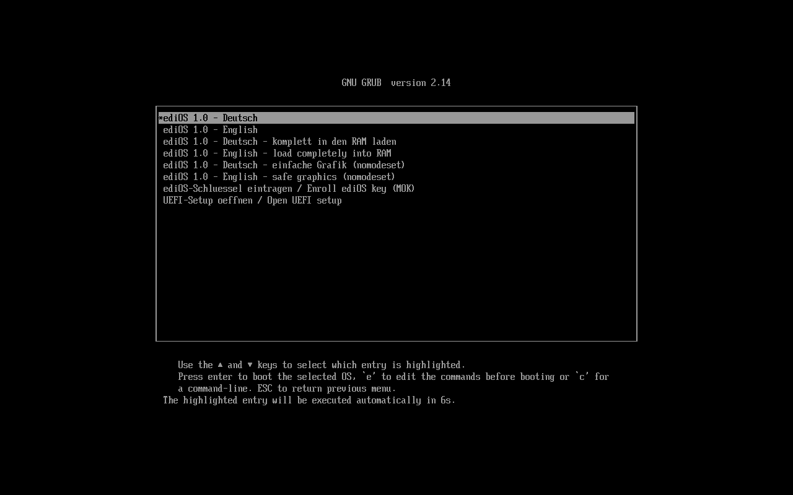
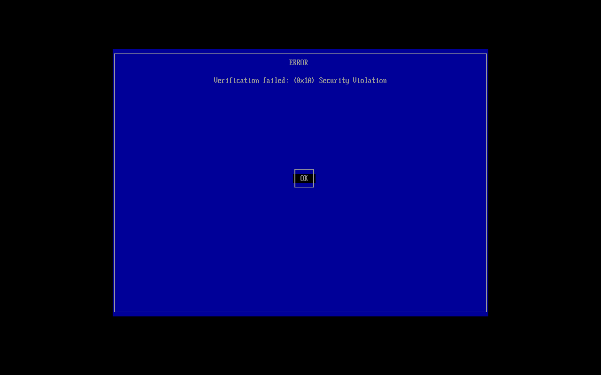
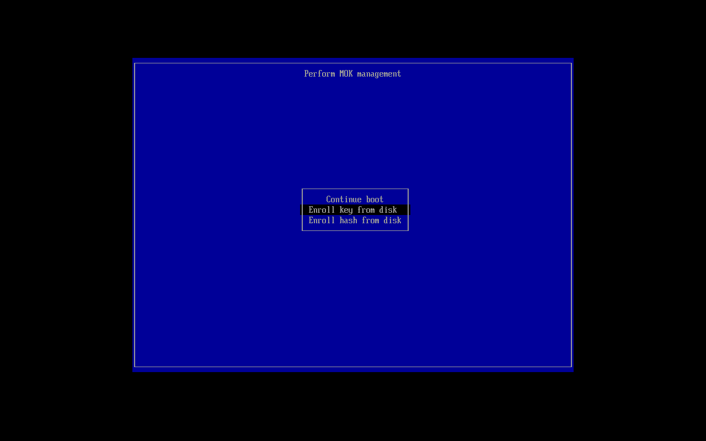
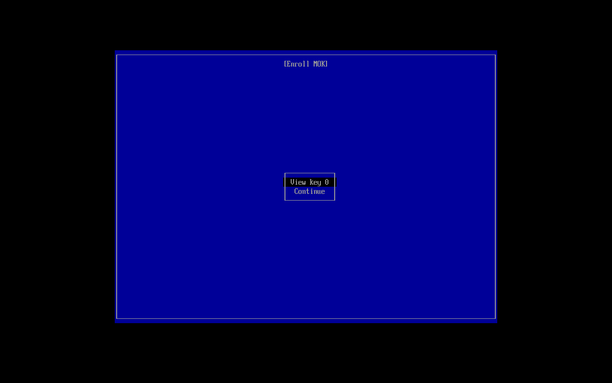
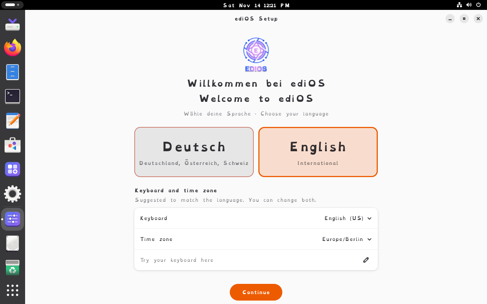
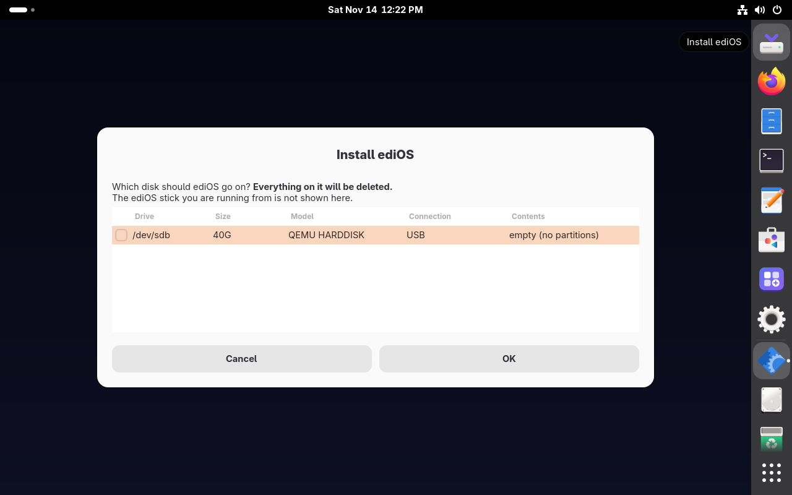
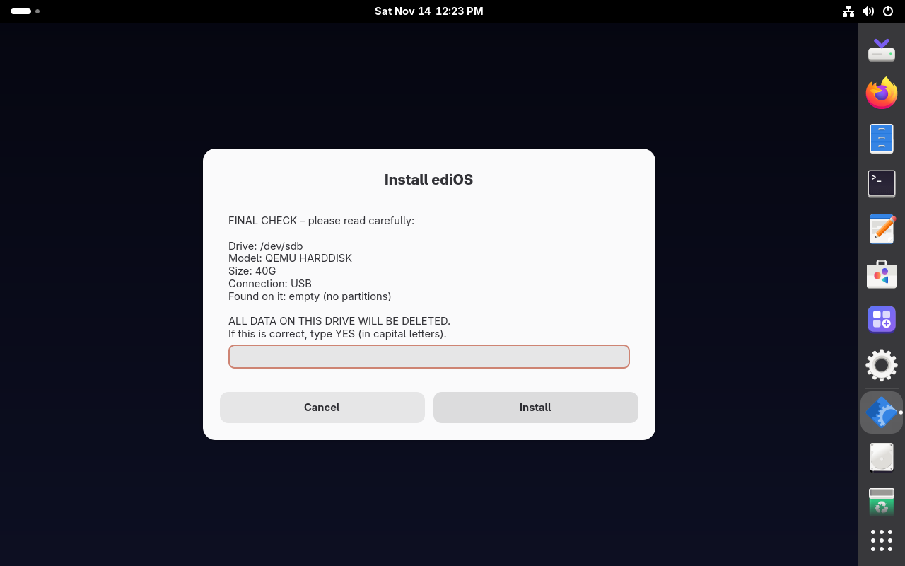
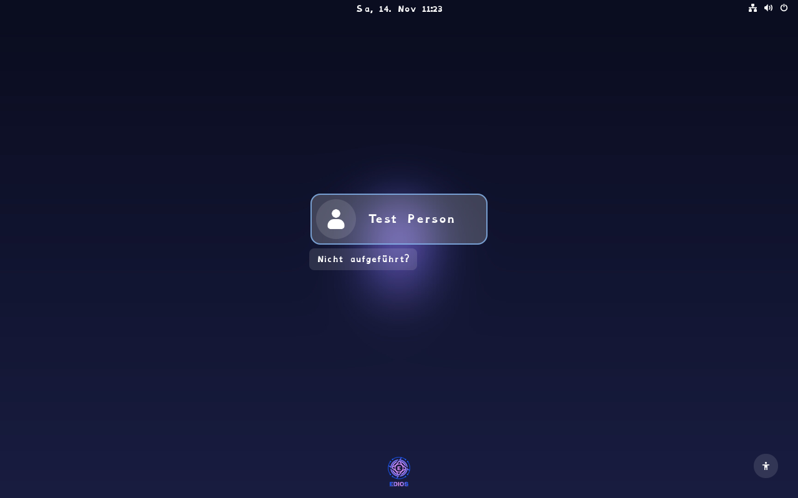
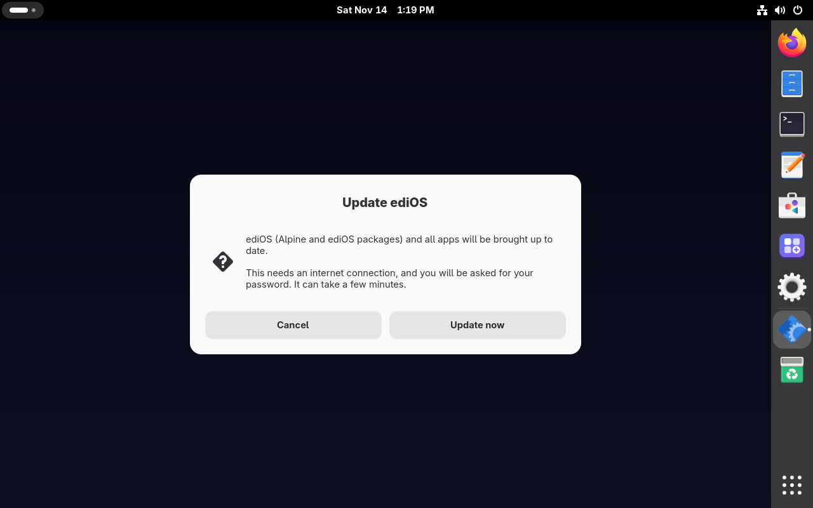
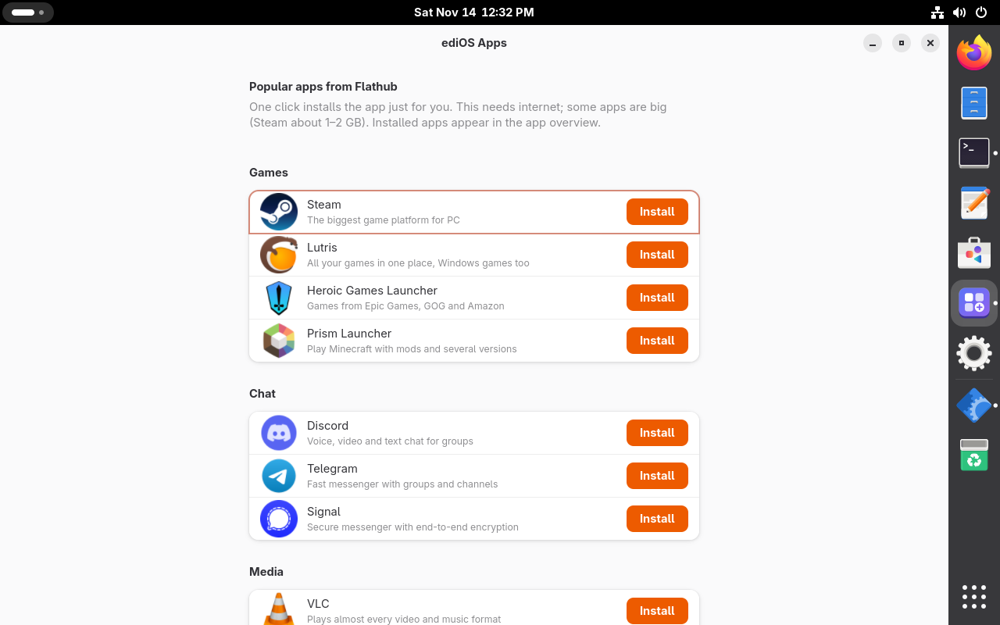

# Installing ediOS – step by step

[Deutsch](../de/installation.md) · [Back to the overview](../../README.md)

This guide is written for beginners. You need about 30–45 minutes.

**You need:**
- a PC with UEFI (almost all PCs since 2012) and at least 4 GB of memory
- a USB stick with at least 4 GB – **everything on it will be deleted**
- to install, a disk with at least 12 GB, easiest is an **external USB SSD**
  (then your Windows stays untouched)
- internet for the download (about 2 GB)

> **Important:** installing deletes the chosen disk completely. Back up your data first.

---

## 1. Download the ISO

1. Open the **[Releases](https://github.com/edululilar-sketch/ediOS/releases/latest)** page.
2. Under "Assets" download these files:
   - `edios-1.0-x86_64.iso` – this is ediOS (about 1.9 GB)
   - `SHA256SUMS` – the checksum

## 2. Check the checksum

This makes sure the file is complete and unchanged.

**Windows:** open the Downloads folder, right-click an empty area → "Open in Terminal" (or PowerShell) and type:

```powershell
Get-FileHash .\edios-1.0-x86_64.iso -Algorithm SHA256
```

Compare the number shown with the line in `SHA256SUMS` (open it with Notepad). It must be **exactly the same**
(upper/lower case does not matter). If it is different: delete the file and download it again.

**Linux/macOS:** `sha256sum -c SHA256SUMS --ignore-missing` must report `OK`.

<details><summary>Advanced: check the signature</summary>

`SHA256SUMS.sig` is signed with the ediOS package key. The public key `edios-repo.rsa.pub` is attached to the
release and in the repository under `src/pubkeys/`.

```sh
openssl dgst -sha256 -verify edios-repo.rsa.pub -signature SHA256SUMS.sig SHA256SUMS
```

Output: `Verified OK`.
</details>

## 3. Create the USB stick

### With Rufus (Windows)
1. Download **Rufus** from <https://rufus.ie> (the "Portable" version is enough) and start it.
2. **Device:** choose your USB stick. Look closely – it must not be a hard disk!
3. **Boot selection:** click "SELECT" and choose `edios-1.0-x86_64.iso`.
4. **Partition scheme:** GPT, **Target system:** UEFI (non CSM).
5. Click **START**. Rufus asks how to write the image: choose **"Write in DD Image mode"**.
6. Confirm the warning "all data will be destroyed" with OK and wait until "READY" appears.

### With balenaEtcher (Windows, macOS, Linux)
1. Install **balenaEtcher** from <https://etcher.balena.io> and start it.
2. "Flash from file" → choose `edios-1.0-x86_64.iso`.
3. "Select target" → choose the USB stick.
4. Click "Flash!" and wait until "Flash Complete" appears.

## 4. Start from the stick in the BIOS/UEFI

1. Plug in the stick and **restart** the PC.
2. Right at the start press the key for the **boot menu**. Depending on the maker:

   | Maker | Key |
   |---|---|
   | Acer, Asus (desktop), Dell, Lenovo, Gigabyte, MSI | F12 / F11 |
   | Asus (laptop) | Esc |
   | HP | F9 (or Esc) |
   | Lenovo (some) | F12 or the small "Novo" button |

3. Choose the entry **"UEFI: …"** with the name of your stick.
4. The **ediOS boot menu** appears. Choose **"ediOS 1.0 – English"** with the arrow keys and Enter
   (without a choice, **Deutsch** starts after 8 seconds; you can still switch to English in the setup).



More entries:
- **load completely into RAM:** ediOS copies itself into memory. Afterwards you can remove the stick
  (needs at least 8 GB of RAM).
- **safe graphics:** if the screen stays black.

## 5. Secure Boot: enroll the ediOS key

If **Secure Boot is off**, skip this step.

If **Secure Boot is on**, a message appears at the first start. That is **expected** the first time:



1. Press **Enter** on "OK".
2. A **blue screen** "Shim UEFI key management" appears. **Press a key** within 10 seconds.
3. Choose **"Enroll key from disk"**.

   

4. Choose the drive **"EDIOS"**, then the file **`edios-mok.der`**.
5. Optional "View key": the name must be **"ediOS Secure Boot Signing Key (MOK) 2026-11"**.
6. **"Continue"** → **"Yes"** → **"Reboot"**.



ediOS then starts with Secure Boot. The key only applies to ediOS; Windows keeps starting normally.

## 6. Live system and setup

After about a minute the desktop appears with the **setup**:

1. **Language:** English or German (keyboard and time zone are suggested to match).
   Use the field "Try your keyboard here" to test your keyboard.

   

2. **Font:** e.g. OpenDyslexic, the GNOME default font or Ubuntu – every change applies right away.
3. **Dock position:** left, bottom or right. Then **"Done"**.

Everything you choose here is copied by the installer to the installed ediOS. In the live system you can try
ediOS at your own pace: Wi-Fi (top right), sound, Firefox, Files. Nothing on your PC is changed.

## 7. Installation

1. Click **"Install ediOS"** in the dock (first icon).
2. Read the note and click "Continue".
3. **Choose the disk:** the list shows every disk with size, model, connection and contents
   (e.g. "Windows" or "empty"). The ediOS stick never appears.

   

   If a disk is currently open (e.g. in "Files"), it shows "[mounted]". The installer unmounts it after asking.
4. **User account:** name, user name (lowercase, no spaces) and password.
5. **Final check:** read everything carefully. If it is correct, type **YES** and click "Install".

   

6. The installation takes about 5–10 minutes. At the end "ediOS is installed" appears.

## 8. First start

1. Shut down the PC and **remove the USB stick**.
   - **External disk:** keep it connected. At startup choose the disk in the boot menu (F12/F11/Esc).
     Without a choice the PC starts as before (e.g. Windows).
   - **Internal disk:** ediOS is in the PC's boot menu (on Windows PCs Windows stays first).
2. On the login screen click your user and type your password.

   

3. Language, font and dock are set as in the live system; the setup does not appear again.
   You can change everything later with **"ediOS Setup"** in the app overview.

## 9. Updates and apps

- **"Update ediOS"** (app overview) brings the system, ediOS and your apps up to date. It asks for your
  password. Once a week a notification appears when updates are available.

  

- **"ediOS Apps"** installs popular programs such as Steam, Discord, Spotify or GIMP with one click.

  

- Commands from guides on the internet that use `sudo` work in ediOS.

---

## Problems and solutions

**The stick does not start / does not appear in the boot menu**
- Try another USB port (at the back of the PC, USB 2.0 often works better).
- Turn off "Fast Boot" in the UEFI setup (usually F2 or Del at startup).
- Write the stick with Rufus again, this time with "Write in ISO Image mode".
- If the stick appears twice in the boot menu: choose the entry with **"UEFI:"**.

**Secure Boot error ("Security Violation" or "ediOS could not be started")**
- At the first start this is normal: do step 5.
- No blue screen? Choose **"Enroll ediOS key"** in the ediOS boot menu.
- Nothing works: turn Secure Boot off in the UEFI setup (section "Security" or "Boot"). ediOS then always
  starts. For Windows 11 you can turn it on again later, once the key is enrolled.

**A disk is missing from the installer's list**
- Disks smaller than 12 GB and the ediOS stick itself are not shown.
- Connect an external disk after starting, wait a few seconds and start the installer again.
- NVMe SSDs in some laptops: set "Intel RST"/"RAID" to "AHCI" in the UEFI setup (careful: prepare Windows
  for this first).

**No Wi-Fi**
- Click the network icon at the top right and choose your Wi-Fi.
- No Wi-Fi shown: is a flight-mode switch on? Some very new Wi-Fi chips need newer firmware; use a network
  cable or USB tethering from your phone for now.
- Please report your Wi-Fi chip as a bug (output of `lspci -nn` in a terminal).

**The screen stays black**
- Choose **"safe graphics"** in the ediOS boot menu.

More help: [report a bug](https://github.com/edululilar-sketch/ediOS/issues/new/choose).
